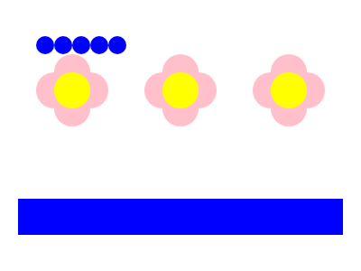
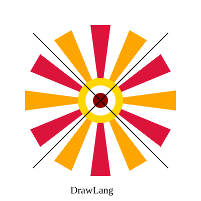
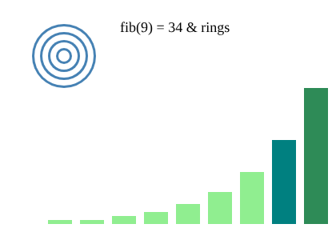
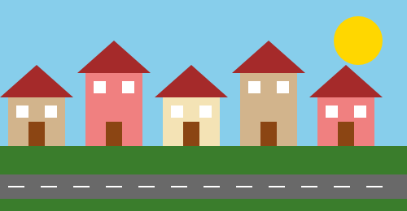

# DrawLang

🎨 **Paint with code.** DrawLang is a tiny painter-style language where you `swirl` through loops, `stamp` out patterns, and `spin` shapes into rosettes, and out comes a crisp `picture.svg` you can open in any browser. It is built with **Flex, Bison and C**, and share one lexer, one set of compile-time checks and one SVG runtime.

## Team 
- Rohail Aamir
- Noor Fatima
- Maheen Kamran

FAST NUCES

## Instructor
- Dr. Faisal Aslam

## Overview 

| Tool | What it does |
|---|---|
| `drawi` | **Interpreter.** Flex + Bison parse, check and run the program directly. |
| `drawc` | **Compiler.** Same front end, but it prints LLVM IR, which is turned into a native executable. |

```
.draw file → Flex → Bison → checks → run directly        → picture.svg   (drawi)
                                   → LLVM IR → llc → clang → executable → picture.svg   (drawc)
```

## Quick start

```bash
# Ubuntu/Debian (other distros: "Requirements")
sudo apt-get install -y flex bison gcc make llvm clang

make                                    # build everything
./drawi examples/02_rosette.draw        # run with the interpreter
make run-compiled SRC=examples/02_rosette.draw   # run with the compiler
```

Open `picture.svg` in any web browser to see the result.

## Requirements

You need `flex`, `bison`, `gcc`, `make`, `llvm` (for `llc`) and `clang`. LLVM 15 or newer is required . Tested on Ubuntu 24.04 with flex 2.6.4, bison 3.8.2, gcc 13 and LLVM 18.

| Distro | Command |
|---|---|
| Ubuntu / Debian | `sudo apt-get install -y flex bison gcc make llvm clang` |
| Fedora / RHEL | `sudo dnf install -y flex bison gcc make llvm clang` |
| Arch | `sudo pacman -S --needed flex bison gcc make llvm clang` |

## Building

```bash
make               # both phases
make interpreter   # only ./drawi
make compiler      # only ./drawc and build/runtime.o
make clean         # remove everything that was built
```


## Running

**Interpreter**

```bash
./drawi [file.draw]          # default input: source.draw
make run-interp SRC=examples/02_rosette.draw
```

**Compiler**

```bash
make run-compiled SRC=examples/02_rosette.draw   # runs all steps below, output in build/out/
```

Or step by step:

```bash
./drawc examples/02_rosette.draw -o program.ll                    # DrawLang → LLVM IR
llc -filetype=obj -relocation-model=pic program.ll -o program.o   # IR → object file
clang program.o build/runtime.o -lm -o program                    # link with the SVG runtime
./program                                                         # writes picture.svg
```

Usage: `./drawc [file.draw] [-o output.ll]` (defaults: `source.draw`, `out.ll`).

## Testing

```bash
make test
```

Runs every program in `examples/` through both phases and checks that:

- both `picture.svg` files are byte-for-byte identical,
- messages and exit codes match,
- the `*error*` examples are rejected and all others succeed.

Expected result: `7 passed, 0 failed`. Outputs are kept in `build/test/<example>/`.

## Example program

```
canvas 400 300;

pattern flower(x, y, size) {
  pen "pink";
  circle(x, y - size, size);  circle(x, y + size, size);
  circle(x - size, y, size);  circle(x + size, y, size);
  pen "yellow";
  circle(x, y, size);
}

ink i = 0;
swirl (i < 3) { flower(80 + i * 120, 100, 20); i = i + 1; }

pen "blue";
rect(20, 220, 360, 40);
stamp 5 times { circle(50, 50, 10); slide 20 0; }
```

This draws three pink flowers with yellow centres, a blue bar, and a row of five blue circles.

{width=45%}

## Language reference

### Keywords

| Concept | DrawLang | Example |
|---|---|---|
| variable | `ink` | `ink i = 0;` then `i = i + 1;` |
| if / else | `when` / `otherwise` | `when (x > 1) { ... } otherwise { ... }` |
| else-if | `otherwise when` | `... otherwise when (x > 0) { ... }` |
| while loop | `swirl` | `swirl (i < 3) { ... }` |
| counted loop | `stamp N times` | `stamp 5 times { ... }` |
| function | `pattern` | `pattern flower(x, y, size) { ... }` |
| return | `give` | `give n * 2;` |

### Drawing statements

| Statement | Meaning |
|---|---|
| `canvas W H;` | Image size. Must be the **first** statement; positive number literals only. |
| `pen "colour";` | Colour for later shapes (default `black`). Any SVG colour name (any case), `#rgb` or `#rrggbb`. |
| `circle(x, y, r);` | Filled circle. |
| `rect(x, y, w, h);` | Filled rectangle; (x, y) is the top-left corner. |
| `line(x1, y1, x2, y2);` | Line, 2 pixels wide. |
| `triangle(x1, y1, x2, y2, x3, y3);` | Filled triangle. |
| `text(x, y, size, "words");` | Text starting at baseline position (x, y). |
| `slide dx dy;` | Shifts the drawing position for all later shapes (also inside patterns). Undo it with negative values. |
| `spin(angle) { ... }` | Rotates the block clockwise by `angle` degrees around the current position. |
| `grow(factor) { ... }` | Scales the block by `factor` (> 0) around the current position. |

Arguments can be any expressions. `spin` and `grow` blocks can be nested.

### Expressions

- Numbers are doubles (`3`, `2.5`).
- Arithmetic: `+ - * / %` and unary `-`.
- Comparison: `< > <= >= == !=`, giving `1` or `0`.
- Logic: `&&`, `||` (short-circuit) and `!`. Any non-zero value is true.
- Pattern calls: `fib(n - 1)`.
- Precedence, low to high: `||`, `&&`, `== !=`, `< > <= >=`, `+ -`, `* / %`, unary.
- Comments: `// line` and `/* block */`.

### Variables and patterns

- Declare with `ink name = expr;`, change with `name = expr;`. Declare before use.
- The main program and each pattern have **separate** variables. Patterns can't see the main program's variables, so pass values as arguments.
- Patterns are defined at the top level. They can be called before their definition, from other patterns, and recursively.
- A call can be a statement (`flower(80, 100, 20);`) or part of an expression (`ink h = fib(i) * 5;`).
- A pattern that ends without `give` returns `0`.
- `stamp N times` evaluates `N` once and runs the block while a counter (0, 1, 2, …) is less than `N`. So `stamp 2.5 times` runs 3 times, and a negative `N` runs 0 times.

### Language notes

`slide` takes two expressions with no comma, so `slide 20 -5;` means dx = 20, dy = −5. The one ambiguity is `slide a (b);`, which Bison reads as a pattern call `a(b)`. Write `slide a b;` instead. This is the single shift/reduce conflict.

## Error checking

Before anything runs (or any IR is written), the checker reads the whole program and reports **every** error with its line number. It then exits with code 1 and writes no `picture.svg`.

| Check | Example message |
|---|---|
| Shape outside canvas | `file:6: error: rect(150, 150, 100, 20) is outside the 200x200 canvas` |
| Negative size or radius | `file:5: error: circle radius is negative (-5)` |
| Unknown colour | `file:4: error: unknown colour "pinkish"` |
| Wrong argument count | `file:8: error: circle expects 3 argument(s) but got 2` |
| Undeclared variable | `file:11: error: undeclared variable 'b'` |

Other checks: unknown pattern, variable declared twice, `give` outside a pattern, missing or misplaced `canvas`, non-positive `grow` factor, syntax errors and unexpected characters.

**Run-time checks.** Shapes whose values depend on variables, loops or parameters can't be checked in advance. They are checked with the same rules at the moment they are drawn:

```
line 7: runtime error: circle(200, 50, 10) is outside the 200x100 canvas
```

The partial `picture.svg` is deleted, and both phases behave identically.

> The canvas check uses the position after `slide`s, in the shape's own unrotated, unscaled frame. `spin` and `grow` are not taken into account.

## Examples

| File | Shows |
|---|---|
| `01_sample.draw` | Basic shapes, a pattern, `swirl`, `when`, `stamp`. |
| `02_rosette.draw` | `spin`, `grow`, `triangle`, `line`, `text`, `otherwise when`. |
| `03_recursion.draw` | `give`, recursion, `&&`, `||`, `%`. |
| `04_town.draw` | `slide`, patterns, hex colours, a dashed road. |
| `05_error_drawing.draw` | Compile-time drawing errors. |
| `06_error_names.draw` | Argument-count, undeclared-variable and unknown-pattern errors. |
| `07_error_runtime.draw` | Run-time canvas error from a loop. |

{width=45%}
{width=45%}
{width=55%}

## How it works

1. **Lexer** (`drawlang.l`) turns text into tokens, each with a line number.
2. **Parser** (`interp.y` / `compiler.y`) builds a syntax tree (`ast.h`) that mirrors the source.
3. **Checker** (`check.c`) reports all compile-time errors and links variables to numbered slots and calls to patterns.
4. **Back end**, the only part that differs:
   - *Interpreter:* walks the tree and calls the runtime directly.
   - *Compiler:* walks the tree and prints LLVM IR. Patterns become `@dl_<name>` functions, variables become `alloca`/`load`/`store`, control flow becomes basic blocks, and shapes become calls like `call void @svg_circle(...)`.
5. **Runtime** (`runtime.c`) holds the `svg_*` functions that write the SVG. Both phases use it, which is why their output is identical.

## Project layout

```
Makefile, test.sh      build and test scripts
source.draw            default input (same as examples/01_sample.draw)
src/drawlang.l         Flex lexer (shared)
src/interp.y           Bison grammar + evaluator   → drawi
src/compiler.y         Bison grammar + IR emitter  → drawc
src/ast.[ch]           syntax tree
src/check.c            compile-time checks (shared)
src/runtime.[ch]       SVG runtime and shape rules (shared)
examples/              sample programs
docs/images/           expected-output pictures
```

`make clean` removes `drawi`, `drawc`, `build/` and `picture.svg`.

